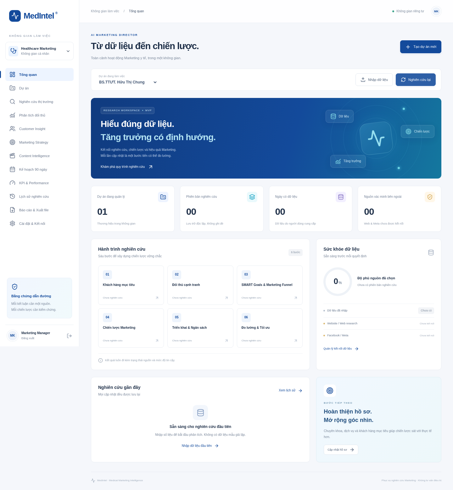

# MedIntel — Medical Marketing Intelligence

MVP dashboard tiếng Việt cho quản lý dự án và phân tích Marketing y tế. **Chưa phải hệ thống nghiên cứu thị trường hoàn chỉnh.** Không có dữ liệu nghiên cứu giả, không chẩn đoán hoặc chỉ định điều trị.



## Mở trực tiếp trong trình duyệt, không cài trên máy

[**Mở MedIntel bằng GitHub Codespaces**](https://codespaces.new/quachthuylinh071298-prog/chatgpt-?ref=feat%2Fmedical-marketing-mvp)

1. Đăng nhập GitHub, giữ nhánh `feat/medical-marketing-mvp`, bấm **Create codespace** nếu tài khoản còn hạn mức phù hợp. GitHub quản lý hạn mức/chi phí; repository không tự tạo môi trường hay dịch vụ trả phí.
2. Chờ cài đặt và build lần đầu. Website cùng worker sẽ tự khởi động; trình duyệt có thể tự mở ứng dụng.
3. Nếu chưa mở: chọn tab **PORTS** phía dưới, tìm cổng **3000**, bấm biểu tượng quả địa cầu **Open in Browser**. Giữ chế độ cổng **Private**.
4. Trong danh sách file bên trái, mở `.env.local`. Mật khẩu đăng nhập là phần sau `APP_PASSWORD=`. Không chia sẻ file hoặc dòng `SESSION_SECRET`.
5. Dừng Codespaces khi dùng xong. Dữ liệu chỉ còn khi workspace còn tồn tại; sao lưu trước khi xóa Codespaces.

**Đây là môi trường xem trước theo yêu cầu, chưa phải website trực tuyến chạy liên tục.** Link `http://localhost:3000` trong mục bên dưới chỉ dùng khi bạn chạy ứng dụng trên chính máy của mình. Nếu Codespaces báo hết hạn mức hoặc yêu cầu thanh toán, dừng tại đó; chưa có triển khai trực tuyến khác.

### Nếu Codespaces báo “recovery mode due to a container error”

Cấu hình đầu tiên dùng nhầm image `1-24-bookworm` không tồn tại. Đã sửa thành `24-bookworm` và xác nhận registry trả HTTP 200.

Nếu đã tạo Codespaces trước khi có bản sửa:

1. Bấm vùng **Terminal** bên dưới, nhập `git pull --ff-only` rồi Enter để lấy bản mới trên nhánh hiện tại.
2. Nhấn **Ctrl + Shift + P**, nhập **Codespaces: Rebuild Container**, chọn lệnh đó và xác nhận **Rebuild** nếu được hỏi.
3. Chờ quá trình cài/build hoàn tất. Mở tab **Cổng / PORTS**, tìm **3000**, chọn **Open in Browser**.
4. Nếu vẫn vào recovery, mở tab **creation.log** và gửi các dòng lỗi cuối; chưa nên chạy lệnh npm trong môi trường recovery.

## Chạy xem trước

Cần Node.js **24 LTS** (tối thiểu 22.13), npm và máy có ổ đĩa ghi được. Tại thư mục repository:

```bash
npm ci
npm run setup
npm run dev
```

Lệnh `setup` tạo `.env.local` và hiển thị mật khẩu ngẫu nhiên một lần. Lưu mật khẩu, mở **http://localhost:3000**, đăng nhập. Trong terminal thứ hai, tại cùng thư mục:

```bash
npm run worker
```

Giữ cả hai terminal hoạt động. Nếu không chạy worker, tác vụ nghiên cứu sẽ ở trạng thái chờ. Dữ liệu lưu bền vững tại `data/medical.sqlite`; không đặt trên ổ đĩa tạm hoặc filesystem chỉ đọc. Website và worker phải dùng cùng `DATABASE_PATH` tuyệt đối nếu chạy khác thư mục. Không triển khai bản này lên nền tảng serverless với ổ đĩa tạm.

## Luồng sử dụng

1. Dự án khởi tạo là **BS.TTƯT. Hữu Thị Chung**, fanpage `https://www.facebook.com/BS.TTUT.huuchung`. Đây là dữ liệu từ yêu cầu người dùng, chưa xác minh độc lập. Chuyên khoa, địa điểm, dịch vụ và đối thủ được để trống.
2. Vào **Dự án → Chỉnh sửa** để nhập thông tin thương hiệu, ngân sách 90 ngày và mục tiêu. Có thể tạo nhiều dự án.
3. Chọn **Nhập dữ liệu → Tải mẫu CSV**. Mỗi ngày một dòng tổng hợp; `date` là văn bản `YYYY-MM-DD`. Các cột khác có thể để trống. **Trống = chưa có dữ liệu; 0 = đã đo và bằng 0.**
4. Nhập CSV hoặc XLSX (sheet đầu tiên, tối đa 5 MB / 10.000 dòng). Ngày trùng thay thế **toàn bộ** dòng hiện tại, kể cả các cột bỏ trống. Tệp gốc không được lưu. Dữ liệu Meta xuất nguyên bản cần chuyển về mẫu; không nhập dữ liệu từng bệnh nhân.
5. Chọn **Nghiên cứu lại**, phạm vi thời gian, nguồn và tùy chọn AI. Web/Meta chưa triển khai sẽ được ghi “Không thể truy xuất”. Không có nguồn mới vẫn có thể tạo báo cáo **giới hạn**, nhưng yêu cầu giống hệt phiên bản gần nhất sẽ bị chặn.
6. Theo dõi **Lịch sử nghiên cứu**, mở báo cáo, so sánh hai phiên bản. Báo cáo giữ nguyên ảnh chụp hồ sơ và dữ liệu lúc phân tích.
7. **Báo cáo & Xuất file → Excel** để tải XLSX. **In / Lưu PDF** mở hộp thoại trình duyệt: chọn máy in “Lưu thành PDF”. Chỉ trang báo cáo được thiết kế để in; không có bộ dựng PDF phía server.

## Cột nhập dữ liệu

`date, reach, nonFollowerReach, views, engagements, followers, leads, bookings, showUps, newPatients, spend, revenue, videoStarts, videoCompletions`

- Tổng hợp chung các kênh theo ngày trước khi nhập, tránh trùng dữ liệu. Không dùng dấu phân tách hàng nghìn. Tiền tệ VND.
- `followers`: số tăng thêm không âm trong ngày; MVP chưa hỗ trợ churn âm hoặc tổng follower cuối kỳ.
- Tệp bị từ chối nếu có cột ngoài danh sách, ngày sai, số âm/không hợp lệ, ngày trùng trong cùng tệp hoặc công thức XLSX. Cột bệnh nhân/điện thoại/email không được chấp nhận.
- Reach là tổng lượt theo ngày, **không phải số người duy nhất toàn kỳ**. Không suy luận hiệu quả nhân quả từ bảng này.
- Tỷ lệ chỉ dùng ngày có đủ cả hai đầu vào. Không ghép lead của ngày này với chi phí của ngày khác. Mẫu số 0 trả về thiếu dữ liệu.
- CPL = spend/leads; PAC = spend/newPatients; booking = bookings/leads; show-up = showUps/bookings; engagement = engagements/reach; ROAS = revenue/spend.
- “Retention” hiện chỉ có proxy hoàn tất video = videoCompletions/videoStarts. ROI luôn để trống vì chưa có tổng chi phí đầy đủ. Chưa có báo cáo tăng trưởng follower theo baseline, attribution, hay thống kê người bệnh quay lại.

## Đã hoạt động

- Dashboard responsive, 12 mục điều hướng, nhiều dự án, chỉnh sửa hồ sơ.
- Đăng nhập một quản trị viên, cookie HttpOnly/SameSite, ký HMAC, hết hạn 12 giờ; kiểm tra Origin cho API ghi. Rate limit đăng nhập trong bộ nhớ cho một tiến trình.
- Nhập CSV/XLSX, validation, lưu số liệu tổng hợp và lịch sử nhập; KPI thiếu dữ liệu có nhãn rõ.
- Hàng đợi SQLite và worker riêng, một tác vụ hoạt động mỗi dự án, timeout AI 60 giây; tác vụ bị gián đoạn quá 5 phút được đánh dấu lỗi, có thể chạy lại.
- Báo cáo quy tắc sáu bước, phiên bản bất biến, ảnh chụp dữ liệu/hồ sơ, so sánh chỉ số, nhật ký nguồn và lỗi. Nghiên cứu ngoài chưa cấu hình luôn có nhãn giới hạn.
- Adapter AI OpenAI-compatible, tắt mặc định; khi bật chỉ gửi số liệu tổng hợp và ngân sách, **không gửi tên, hồ sơ, URL, tài liệu, nội dung hoặc văn bản tự do**.
- Content library nhập thủ công, thứ tự ưu tiên lịch hẹn rồi lead, nhận diện trùng **tiêu đề chính xác**. Content Matrix 30/60/90 ngày gồm 60 câu hỏi biên tập khác nhau, dàn ý Reels, nháp Facebook và gợi ý A/B test có nhãn giả định. Lịch 90 ngày lặp lại 30 chủ đề ở dạng hỏi đáp mở rộng; chưa cá nhân hóa bằng nghiên cứu thực tế.
- Kế hoạch 90 ngày, phân bổ ngân sách 30/40/30 tự tính, khung phụ trách và nhịp tuần. Đây là đề xuất, không phải dự báo hay hệ thống quản lý công việc.
- XLSX gồm tóm tắt sáu bước, KPI, nguồn, 30 mẫu Content Matrix và kế hoạch 90 ngày theo hồ sơ đã chụp. PDF qua In trình duyệt.

## Chưa hoạt động / cần mở rộng

- Tìm kiếm web, crawler website, Meta Graph OAuth/API, thu thập thị trường và benchmark đối thủ có bằng chứng. Hiện connector chỉ báo trạng thái chưa triển khai, **không gọi nguồn ngoài**.
- Engine không tự suy ra persona, SWOT, bản đồ định vị, thị trường hoặc hiệu quả nội dung khi thiếu bằng chứng. Kết quả quy tắc là checklist và dữ liệu người dùng, không phải phân tích chuyên gia hoàn chỉnh.
- Chưa có nhập PDF/DOCX, phân tích tài liệu, bản xuất Meta trực tiếp, content gap tự động, bài Facebook hoàn chỉnh, kịch bản chuyên khoa hoặc chiến lược organic tự động đã kiểm chứng.
- Chưa có PostgreSQL/Prisma, nhiều tài khoản/RBAC, RACI tùy biến, checklist tương tác, lịch giao việc, nhắc hạn, dashboard biểu đồ theo chuỗi thời gian hoặc báo cáo tuần/tháng/quý tự động.
- Chưa có AI API key: không kiểm thử được phản hồi AI thực tế. Bật provider không biến bản phân tích thành nghiên cứu web.
- SQLite phù hợp một máy và khối lượng MVP. Chưa có mã hóa ổ đĩa, quản lý khóa, backup tự động, audit người dùng, xóa/xuất tài khoản hay hardening đa tenant. Chỉ dùng với số liệu Marketing tổng hợp trong không gian hạn chế truy cập.

## Cấu hình AI tùy chọn

Sao chép các tên biến từ `.env.example` vào `.env.local`:

```dotenv
AI_PROVIDER=openai
OPENAI_API_KEY=
OPENAI_BASE_URL=https://api.openai.com/v1
OPENAI_MODEL=gpt-4.1-mini
```

Nhập key trực tiếp trên máy chủ, không gửi qua chat, không commit. Khởi động lại **cả website lẫn worker**. Khi tạo nghiên cứu, tích “Sử dụng AI”. Lời gọi chỉ diễn ra khi có key và người dùng chọn sử dụng; phí API do nhà cung cấp tính. Không tự mua hoặc đăng ký dịch vụ. AI lỗi/timeout được ghi trong báo cáo, không giả lập thành công.

## Production trên một máy

```bash
npm run build
npm run start
# tiến trình riêng cùng thư mục và .env.local
npm run worker
```

Đặt `APP_ORIGIN=https://ten-mien-cua-ban` (không có dấu `/` cuối) khi chạy sau reverse proxy HTTPS. Chạy website và **một worker** bằng process manager, đặt reverse proxy HTTPS và giới hạn request 6 MB. Không mở cổng dev ra Internet. Rate limit hiện chỉ trong bộ nhớ; cần rate limit ở proxy nếu mở rộng. Sao lưu SQLite bằng online backup API hoặc dừng cả hai tiến trình rồi sao chép database (bao gồm WAL/SHM khi liên quan). Không chỉ sao chép tệp chính khi tiến trình đang ghi. Không chuyển môi trường trước khi xuất bản sao lưu và kiểm tra phục hồi.

## Kiểm thử

```bash
npm run lint
npm run typecheck
npm test
npm run build
```

Unit tests bao phủ KPI thiếu dữ liệu, baseline bằng 0, độ phủ tử/mẫu, budget, nhập CSV/XLSX, công thức và ngày không hợp lệ. Integration test chạy API handler với database tạm: đăng nhập, CSRF, tạo dự án, import, queue, worker, lưu phiên bản, chặn trùng, nghiên cứu lại, so sánh và đọc XLSX; kiểm tra cô lập dự án và AI chưa cấu hình. Dữ liệu kiểm thử được tạo riêng, không xuất hiện trong ứng dụng.

GitHub Actions chạy lint, test và build trên Node 24. Xem [kiến trúc](docs/ARCHITECTURE.md), [schema SQLite](docs/schema.sql) và [biên bản xác minh](docs/VALIDATION.md).
