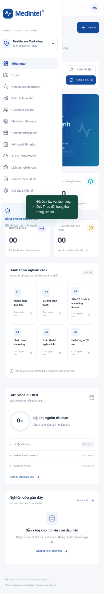

# Biên bản xác minh MVP

Kiểm tra ngày 17/10/2026 trên Linux, Node.js 24.19.0, Next.js 15.5.28. Các phép thử dùng database SQLite tạm và dữ liệu tổng hợp kiểm thử; không lưu số liệu giả vào dự án khởi tạo.

## Kết quả

| Kiểm tra            | Kết quả         | Phạm vi                                                                   |
| ------------------- | --------------- | ------------------------------------------------------------------------- |
| `npm run build`     | Đạt             | Production build, type validation và lint tích hợp                        |
| `npm run lint`      | Đạt             | ESLint Next.js/TypeScript                                                 |
| `npm run typecheck` | Đạt             | TypeScript strict                                                         |
| `npm test`          | Đạt             | 10 unit test + 1 integration test gồm nhiều bước API                      |
| Chromium desktop    | Đạt             | Viewport 1440×1100, không có page error                                   |
| Chromium mobile     | Đạt             | Viewport 390×844, menu và điều hướng, không tràn ngang document           |
| XLSX                | Đạt             | Tải tệp từ UI; integration mở được byte stream ZIP Excel                  |
| PDF                 | Đạt về dựng tệp | Chromium in trang báo cáo thành PDF; chưa kiểm tra mọi trình duyệt/máy in |
| `git diff --check`  | Đạt             | Không có lỗi whitespace                                                   |

## Các bước kiểm thử trình duyệt đã chạy

1. Server production và worker chạy trên cùng database riêng cho QA.
2. Đăng nhập bằng mật khẩu ngẫu nhiên, không ghi vào source.
3. Mở dashboard dự án bác sĩ mặc định, không có KPI giả.
4. Tạo dự án riêng cho QA qua biểu mẫu.
5. Upload CSV tổng hợp, xác nhận không có dữ liệu định danh.
6. Tạo nghiên cứu, worker xử lý và lưu báo cáo giới hạn v1.
7. Mở báo cáo, dựng PDF bằng print CSS và tải Excel.
8. Kiểm tra màn hình KPI và Content Matrix.
9. Kiểm tra menu, chuyển dự án và layout trên màn hình 390px.
10. Dừng server và worker do bài kiểm tra khởi tạo.

Browser QA đã phát hiện lỗi Origin khi truy cập qua host công khai khác localhost. Đã sửa để dùng host yêu cầu hoặc `APP_ORIGIN` được cấu hình; integration test có trường hợp hồi quy. Reverse proxy HTTPS cần khai báo `APP_ORIGIN` theo README.

## Chưa được xác minh

- Không có AI API key: chưa gọi OpenAI thực tế, chưa kiểm tra chất lượng phản hồi/model availability hoặc hạn mức tài khoản.
- Web research, website crawl và Meta API chưa triển khai: không có kết quả nghiên cứu bên ngoài đã xác minh.
- Chưa có kiểm tra tải lớn, penetration test, ZIP bomb sandbox, nhiều worker/máy chủ, nhiều tài khoản hoặc backup/restore production.
- Không có deployment công khai. Bản xem trước chạy trên máy người dùng theo README; không tự đăng ký dịch vụ trả phí.
- Ảnh di động được chụp sau khi tạo thêm một dự án QA; con số dự án trong ảnh không phải dữ liệu sản xuất. Các báo cáo kiểm thử không được commit.

## Ảnh giao diện

## Sửa lỗi cấu hình Codespaces

Ảnh người dùng gửi cho thấy Codespaces ở recovery mode trước khi cài ứng dụng. Kiểm tra trực tiếp registry MCR phát hiện tag `devcontainers/javascript-node:1-24-bookworm` trả HTTP 404 MANIFEST_UNKNOWN. Tag `devcontainers/javascript-node:24-bookworm` trả HTTP 200 (manifest digest tại thời điểm kiểm tra: `sha256:16eb68aa0d17eedaaf2566b180854fe4e506478e35aadf790fb02aa089024f13`). Đã sửa devcontainer sang tag tồn tại và thêm hướng dẫn pull + rebuild cho Codespaces đã tạo. Chưa có quyền truy cập Codespaces của người dùng để xác minh rebuild thực tế; không khẳng định ứng dụng trong Codespaces của người dùng đã chạy.

## Sửa đăng nhập sau proxy Codespaces

Thông báo “Yêu cầu không cùng nguồn” trên ảnh đăng nhập cho thấy request bị CSRF từ chối trước khi kiểm tra mật khẩu. Đã tách `lib/request-origin.ts`: nhận diện Fetch Metadata `Sec-Fetch-Site: same-origin` do trình duyệt đặt, yêu cầu Origin HTTP/HTTPS hợp lệ, từ chối metadata cross-site/same-site. Trình duyệt không có Fetch Metadata dùng APP_ORIGIN hoặc hostname Codespaces chính xác từ môi trường; không tin tùy ý header X-Forwarded-Host. Cookie Secure được xác định từ Origin đã kiểm tra.

Kiểm thử thêm trường hợp URL nội bộ HTTP localhost, Origin bên ngoài HTTPS Codespaces, cookie Secure, origin thiếu/null, hostname Codespaces khác và cross-site. Kết quả: 10 unit test + 1 integration test đạt; production build kèm lint/typecheck đạt. Chưa kiểm tra trực tiếp trên Codespaces của người dùng; cần pull và rebuild để thay tiến trình đang chạy bản cũ.

## Cập nhật tiến trình đang chạy

Thêm `npm run repair` dành cho Codespaces Linux: nhận diện website/worker theo cwd chính xác và lệnh chương trình, loại trừ bản thân và tiến trình không liên quan, gửi SIGTERM chờ kết thúc, build, khởi động lại và xác minh API trả `loginVersion: 2`. Giữ nguyên mật khẩu, SQLite và các file dữ liệu. UI hiện “Bản đăng nhập: 2” để phân biệt máy chủ đã cập nhật với bản cũ.

Unit test thêm trường hợp không dừng ứng dụng ở repository khác hoặc Node process không liên quan. Kiểm tra runtime riêng với cấu hình/database QA tạm: chạy hai tiến trình cũ, repair, xác nhận PID cả hai được thay mới, cấu hình được giữ, login HTTPS-origin qua HTTP nội bộ trả 200 và cookie Secure, cross-site trả 403. Không có quyền chạy repair trực tiếp trên Codespaces của người dùng; người dùng cần chạy lệnh trên Terminal của Codespaces đó.
